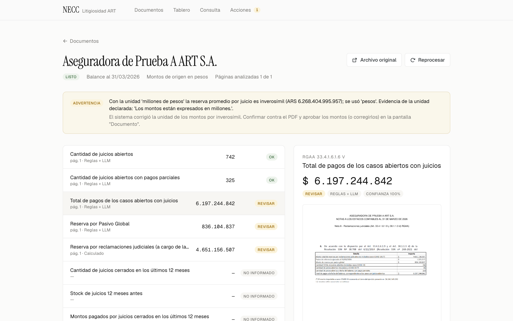
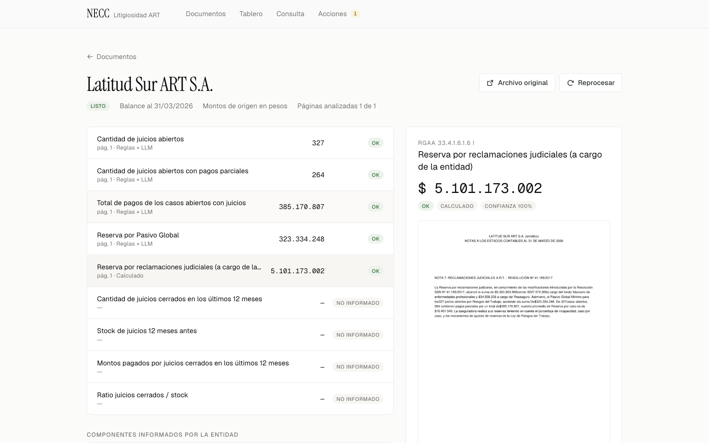
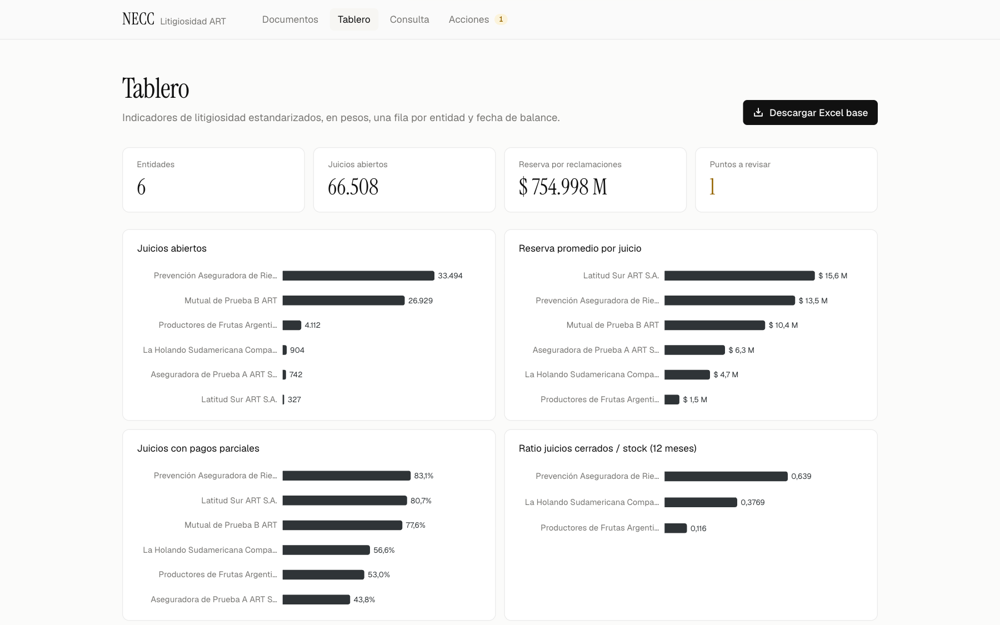

| | |
|---|---|
| **Materia** | Text Mining — Maestría en Ciencia de Datos, Universidad Austral |
| **Docente** | Prof. Dr. Hernán D. Merlino |
| **Cohorte** | 2026-2027 |
| **Fecha** | 16/10/2026 |
| **Integrantes** | [completar] |
| **Documento** | Resumen ejecutivo. |

**Convención.** Las cifras de este documento salen de la evaluación del MVP (`mvp/eval/resultados.md`) o del requerimiento de negocio (`Info NECC.docx`). Las que no fueron medidas se marcan como *estimación* o *supuesto*.

# 1. Resumen ejecutivo

**Problema.** Todos los trimestres, las aseguradoras de riesgos del trabajo (ART) presentan sus estados contables ante la SSN. En las Notas informan sus datos de litigiosidad: el punto RGAA 33.4.1.6.1.6 pide reservas, juicios abiertos y pagos parciales, y el nuevo formato normalizado (RGAA 30.1.1.3 d) agrega juicios cerrados, stock y ratio. Hoy un analista lee cada PDF y copia los valores a mano a un "Excel base". Cada entidad redacta distinto: hay más de 10 nombres para un mismo concepto, cuadros escaneados como imagen, unidades mezcladas y valores que hay que sumar o restar. El resultado es trabajo calificado y repetitivo, riesgo de errores de transcripción y ninguna trazabilidad sobre el origen de cada número.

**Solución.** NECC · Litigiosidad ART extrae los 9 indicadores de litigiosidad de las notas de las ART y los carga en el Excel base, con página y cita para cada valor y alertas cuando algo no cierra. Dos métodos independientes (reglas derivadas de una ontología y un LLM) leen cada campo. Todo número tiene que aparecer literalmente en la página de la que se dice que sale. Los desacuerdos se derivan a una persona, con una acción concreta sugerida.

**Resultado medido (MVP).** Probamos el MVP con 6 notas: 3 reales al 31/03/2026 (La Holando, Productores de Frutas y Prevención ART) y 3 sintéticas con las variantes más difíciles (cuadro escaneado, comparativo escaneado en miles y prosa con restas). En total son 54 valores. Las reglas acertaron **54/54**, la IA sola **51/54 (94,4 %)** (50/54 en una corrida anterior) y el híbrido **54/54**; la página correcta se localizó en **6/6** notas. El proceso tardó entre 9 y 21 s por nota y el costo de API es de **≈ USD 0,02 por nota** (*estimación*).

**Advertencia.** Las reglas se ajustaron sobre estas mismas notas, así que el 54/54 es optimista. El piloto mide sobre un trimestre completo de notas no vistas.

**Lo que compra el cliente.** El caso no se apoya en horas ahorradas (ver sección 9): son pocas notas por año. Lo que se compra es control de errores, trazabilidad para auditoría, el dato el mismo día en que se publica la nota y escala para sumar indicadores nuevos por configuración.

**Pedido.**

1. Aprobar el piloto de 3 meses (≈ **USD 15.070**, con decisión al final de cada mes).
2. Designar un analista de dominio a media jornada.
3. Dar acceso a un trimestre de notas y al Excel base actual.

# 2. El problema y por qué importa

## 2.1 Qué hay que extraer

En la versión actual, el Excel base tiene **9 campos** por entidad y fecha de balance. Los 5 primeros vienen del punto 33.4.1.6.1.6. Los otros 4 vienen del formato normalizado (30.1.1.3 d):

1. Cantidad de juicios abiertos.
2. Cantidad de juicios abiertos con pagos parciales.
3. Total de pagos de los casos abiertos con juicios.
4. Reserva por pasivo global.
5. Reserva por reclamaciones judiciales (a cargo de la entidad).
6. Juicios cerrados en los últimos 12 meses.
7. Stock de juicios 12 meses antes.
8. Montos pagados por juicios cerrados en 12 meses.
9. Ratio juicios cerrados / stock.

## 2.2 Por qué no alcanza con "buscar y copiar"

El requerimiento (`Info NECC.docx`) documenta variantes reales que hoy se resuelven de memoria:

- **Sinónimos.** Hay más de 10 formas de nombrar el total de pagos. Algunos ejemplos: "Total de pagos a la fecha de balance de los casos abiertos", "Total de pagos parciales actualizados correspondientes a juicios abiertos" y "Monto pagado al 31/03 correspondiente a casos abiertos". El pasivo global y la reserva por reclamaciones tienen 6–9 redacciones cada uno.
- **Formatos.** Los datos aparecen como lista, cuadro, cuadro comparativo de dos años, prosa y cuadros escaneados como imagen. Info NECC registra este último caso en al menos tres entidades.
- **Unidades.** Algunas notas están en pesos y otras en miles de pesos. Una entidad declara los estados contables en miles pero las notas en pesos. En otra, el pie de una imagen dice "en millones", pero las cifras solo tienen sentido en pesos.
- **Datos que no están "listos".** A veces los juicios abiertos vienen separados en "sin" y "con" pagos parciales, y hay que sumarlos. Hay casos en que la reserva aparece en prosa y hay que restarle la porción a cargo del fondo fiduciario de enfermedades profesionales (FFEP) y la del reaseguro. Es el caso de Latitud Sur: \$5.363.303.565 − \$227.572.305 − \$34.558.258.
- **Ambigüedades de criterio.** Hay que decidir entre reserva bruta y "saldo según Sinensup", y entre pasivo global bruto y neto.

## 2.3 El riesgo del proceso actual

El costo principal no son las horas sino el **riesgo de error**. Un número mal transcripto, una unidad mal interpretada o una reserva tomada bruta en lugar de neta contaminan el Excel base y todo lo que se calcula a partir de él. Además, hoy no hay forma de auditar de dónde salió cada valor.

Caso real del MVP: un cuadro decía "en millones". Tomado al pie de la letra, daba ARS 6,3 billones por juicio, una reserva inflada por 1.000.000. El sistema lo detectó y alertó al actuario (Figura 1).

# 3. La solución

## 3.1 Proceso de 8 módulos

| # | Módulo | Qué hace | Técnica |
|---|---|---|---|
| 1 | Descubrimiento (`m1_descubrimiento.py`) | Toma documentos de una carpeta vigilada, de la subida web o de la CLI. Deduplica por SHA-256 y guarda una copia inmutable del original. | Adquisición de datos y deduplicación |
| 2 | Procesamiento (`m2_procesamiento.py`) | Extrae el texto nativo con PyMuPDF en orden de lectura. Aplica OCR (Gemini visión, con Tesseract como alternativa) a las páginas escaneadas y a las imágenes grandes, y omite logos repetidos. Limpia viñetas, encabezados y pies, y fragmenta por párrafos sin cruzar páginas. | Limpieza, OCR y fragmentación |
| 3 | Estandarización (`m3_estandarizacion.py`) | (a) Localiza con BM25 usando la ontología como consulta. (b) Extrae por reglas. (c) Extrae por LLM: Gemini 2.5 Flash, temperatura 0, JSON validado con Pydantic y número literal con página y cita. (d) Verifica que el número exista literalmente en la página. (e) Fusiona: si los dos métodos coinciden, la confianza es alta; si no, se abre una alerta. | BM25 guiado por ontología, salida estructurada validada, verificación literal |
| 4 | Pre-procesamiento (`m4_preprocesamiento.py`) | Aplica las derivaciones de la ontología (sumas y restas), normaliza todo a pesos, aplica la barandilla de unidad y las reglas de negocio, y asigna un estado por campo: ok, revisar o faltante. | Ontología como barandilla de reglas |
| 5 | Almacenamiento (`m5_almacenamiento.py`) | Guarda en SQLite los documentos, páginas, fragmentos con embeddings, extracciones por método, valores, alertas, acciones, eventos y consultas. Exporta el Excel base con las hojas Base, Trazabilidad e Incidencias. | Persistencia y trazabilidad |
| 6 | Visualización (`m6_visualizacion/api.py` con FastAPI, interfaz React en `web/`) | Ofrece las pantallas Documentos (carga por arrastre y progreso del procesamiento en 6 pasos), Documento (recorte de la página del PDF con el valor resaltado, lecturas por método, aprobar o corregir), Tablero, Consulta y Acciones. | API e interfaz web |
| 7 | Consulta (`m7_consulta.py`) | Búsqueda híbrida: BM25 más embeddings `gemini-embedding-001`, fusionados con Reciprocal Rank Fusion (k = 60). El contexto son los fragmentos más la tabla estandarizada, con un prompt anclado y citas [entidad, pág.]. | RAG híbrido BM25 + embeddings con RRF |
| 8 | Acción (`m8_accion.py`, `config/responsables.yaml`) | Rutea cada alerta al responsable que corresponde (analista, actuario o líder) según regla y severidad. Envía una notificación con acción sugerida, página y evidencia por bandeja local, Slack o email. Genera reportes por documento y consolidados. | Human-in-the-loop |

Un orquestador (`pipeline.py`) ejecuta los módulos en cadena y deja una bitácora por etapa. Todo se maneja desde la CLI `necc`, con los comandos `descubrir`, `ejecutar`, `procesar`, `vigilar`, `estado`, `consultar`, `exportar`, `reporte`, `evaluar` y `ui`.

## 3.2 Ontología

El conocimiento del dominio vive en `config/ontologia.yaml` y no en el código. Define 9 campos y 5 componentes intermedios: juicios sin pagos parciales, reserva bruta, porción a cargo del FFEP, porción a cargo del reaseguro y pasivo global neto. Para cada campo y componente registra:

- sinónimos y redacciones conocidas;
- criterios de negocio (por ejemplo, reserva **neta**);
- derivaciones determinísticas (juicios = sin + con pagos parciales; reserva = bruta − FFEP − reaseguro);
- reglas de validación que generan alertas.

La ontología funciona como **barandilla** sobre lo que lee el LLM y es auditable por el analista de dominio. Para incorporar una redacción o un indicador nuevo se edita el YAML; no hace falta tocar código. Los 4 indicadores del formato normalizado están definidos de esa forma.

## 3.3 Verificación contra alucinaciones

- **El LLM lee, el código calcula.** El LLM devuelve el número tal como está escrito, con la página y la cita. Las sumas, restas y conversiones de unidad las hace el módulo 4.
- **Verificación literal.** Si el número no aparece en la página citada, la lectura se rechaza.
- **Doble lectura independiente.** Reglas y LLM leen cada campo por separado. Solo el acuerdo entre ambos da confianza alta.
- **Barandilla de unidad.** Si la reserva promedio por juicio no es verosímil con la unidad leída y sí lo es con la del otro método, el sistema corrige la unidad y avisa. Así resolvió el caso "en millones" (Figura 1).
- **Abstención.** Si la entidad no informa un campo, el resultado esperado es "faltante", no un número inventado. El set de referencia incluye estos casos.

{width=16cm}

## 3.4 Revisión humana y módulo de acción

El sistema no publica nada sin control. Cada valor tiene un estado (ok, revisar o faltante). En la pantalla Documento, el analista ve el valor resaltado sobre la página del PDF y las lecturas de cada método, y puede **aprobar o corregir** con su nombre. Las alertas no quedan en un log: el módulo 8 las rutea según `config/responsables.yaml`. Por ejemplo, un problema de unidad va al actuario y un faltante va al analista. Cada notificación incluye una **acción concreta sugerida**, la página y la evidencia. El líder recibe además un reporte por documento y uno consolidado.

{width=16cm}

## 3.5 Técnicas de Text Mining aplicadas

| Técnica | Cómo se aplica |
|---|---|
| Proceso completo de NLP | Adquisición (M1) → limpieza y OCR (M2) → representación con BM25 y embeddings (M3, M7) → extracción con reglas y LLM (M3) → evaluación (`necc evaluar`) → despliegue (M6, M8) |
| BM25 guiado por la ontología | Los sinónimos de la ontología forman la consulta que localiza las 2–4 páginas relevantes en notas de 11–38 páginas |
| Salida estructurada del LLM validada | Temperatura 0, JSON con esquema validado con Pydantic, número literal con página y cita |
| Verificación literal contra alucinaciones | Cada número debe aparecer en la página citada; si no, se rechaza. Abstención con `null` cuando la entidad no informa |
| Búsqueda híbrida BM25 + embeddings con RRF | Consulta libre sobre el corpus con prompt anclado y citas |
| Evaluación por componente | Localización por separado y exactitud por campo y por método contra un set de referencia verificado a mano |
| Human-in-the-loop | Estados por campo, alertas ruteadas con acción sugerida, aprobación o corrección con nombre |

# 4. Criterios aplicados

Estos criterios están codificados en la ontología y en el set de referencia, y se ratifican con el área usuaria en el mes 1 (Diagnóstico):

| Campo | Criterio aplicado | Fundamento |
|---|---|---|
| Reserva por reclamaciones judiciales | **Neta** de la porción a cargo del FFEP y del reaseguro | Variante Latitud Sur de Info NECC; consistente con el "Saldo según Sinensup" de Prevención ART |
| Reserva por pasivo global | **Bruta**; si solo se informa neta, bruta = neta + pagos parciales | Info NECC lista "neto de pagos parciales" como variante |
| Juicios abiertos | **Total, incluidos COVID**; si viene separado, sin + con pagos parciales | Info NECC: "Cantidad TOTAL de juicios abiertos (incluidos casos COVID)" |
| Cuadros comparativos | Siempre el período de la fecha de balance | Evita tomar la columna del año anterior |
| Unidades | Todo se normaliza a pesos; la unidad declarada se contrasta con la barandilla | Casos "EECC en miles, notas en pesos" y "en millones" |

# 5. Resultados del MVP

## 5.1 Diseño de la evaluación

El set de referencia (`eval/gold.yaml`) tiene 6 notas con valores verificados a mano contra cada PDF:

- **3 notas reales al 31/03/2026:** La Holando, Productores de Frutas y Prevención ART. Cubren un cuadro de 2 columnas con texto libre en la celda; una lista con numerales romanos en prosa (EECC en miles, notas en pesos); y un cuadro comparativo 2026/2025 en miles, con los juicios separados y la reserva neta de FFEP.
- **3 sintéticas**, construidas con fragmentos de Info NECC para cubrir variantes difíciles que no estaban en las reales: un cuadro escaneado, un comparativo escaneado en miles y prosa con restas.

Son 9 campos por nota, es decir 54 valores. Cuando la entidad no informa un campo, el valor esperado es `null` (se mide la abstención). La evaluación corre con `uv run necc evaluar` y compara tres configuraciones: solo reglas, IA sola e híbrido (el pipeline completo).

## 5.2 Resultados

| Método | Campos correctos | Exactitud | Notas 100 % | Unidad correcta |
|---|---:|---:|---:|---:|
| Reglas | 54/54 | 100 % | 6/6 | 6/6 |
| IA sola | 51/54 | 94,4 % | 5/6 | 5/6 |
| **Híbrido (pipeline)** | **54/54** | **100 %** | **6/6** | **6/6** |

La localización fue correcta en 6/6 notas.

| Nota | Variante | Reglas | IA sola | Híbrido | A revisar (híbrido) |
|---|---|---:|---:|---:|---:|
| doc_1 · La Holando | Cuadro de 2 columnas con texto libre en celda | 9/9 | 9/9 | 9/9 | 0 |
| doc_2 · Productores de Frutas | Lista en prosa; EECC en miles, notas en pesos | 9/9 | 9/9 | 9/9 | 0 |
| doc_3 · Prevención ART | Comparativo 2026/2025 en miles; reserva neta de FFEP | 9/9 | 9/9 | 9/9 | 0 |
| sintético A | Cuadro escaneado (OCR) | 9/9 | 6/9 | 9/9 | 4 |
| sintético B | Comparativo escaneado en miles (OCR) | 9/9 | 9/9 | 9/9 | 0 |
| sintético C | Prosa; reserva con resta de FFEP y reaseguro | 9/9 | 9/9 | 9/9 | 0 |

**Errores de la IA sola.** En el sintético A tomó "millones" del pie de la imagen y multiplicó tres montos por 10⁶. Por ejemplo, la reserva por reclamaciones dio 4.651.156.507.000.000 en lugar de 4.651.156.507.

El híbrido corrige el error con la barandilla de unidad y las reglas, y **además deja alertas** (4 campos a revisar) para que una persona confirme.

La IA no es determinista: en una corrida anterior la IA sola dio 50/54 (92,6 %), porque además omitió la reserva por reclamaciones del sintético B. El híbrido dio 54/54 en ambas corridas.

**Otras mediciones.**

| Medición | Valor |
|---|---|
| Tiempo por nota | 9–21 s de punta a punta (medido en la bitácora de las 6 notas) |
| Tokens en doc_3 (38 páginas, la más larga) | 4.490 de entrada y 3.821 de salida (incluye 2.658 de "thinking") en la extracción; ≈ 36 mil para los embeddings |
| Costo de API | ≈ USD 0,02 por nota, más ≈ USD 0,002 por imagen con OCR. *Estimación*, ver sección 8.1 |
| Tests automáticos | 33, sobre la parte determinística y la degradación ante fallas: números argentinos, reglas, verificación literal, derivaciones, validaciones, barandilla de unidad, falla del LLM y del OCR |

## 5.3 Limitaciones

- **Las reglas se ajustaron sobre estas mismas notas, así que el 54/54 es optimista.** Mide cobertura de casos conocidos, no generalización. En notas nuevas es esperable que la IA generalice mejor y que las reglas fallen más; por eso el diseño es híbrido, con dos lectores de sesgos distintos y verificación cruzada. El piloto mide sobre un trimestre completo de notas no vistas.
- **Set chico y en parte sintético.** Son 6 notas, y la mitad son sintéticas. No alcanza para dar intervalos de confianza ni para afirmar una exactitud de producción.
- **El valor del híbrido no es solo el acierto.** Convierte los errores en **alertas revisables**. Un error detectado y ruteado vale más que un acierto sin trazabilidad.
- **Tiempo manual sin medir.** Los 20 min por nota son un supuesto; la línea de base se mide en el mes 1.

{width=16cm}

# 6. Plan del piloto

Cada mes termina en un **punto de decisión**: continuar, ajustar o detener.

| Mes | Fase | Actividades | Entregable | Punto de decisión |
|---|---|---|---|---|
| 1 | Diagnóstico | Medir la línea de base manual (tiempo y errores por nota). Juntar un trimestre completo de notas de todas las ART. Ratificar los criterios aplicados. Etiquetar a mano notas no vistas para el set de referencia | Informe de línea de base, set de referencia ampliado y criterios firmados | ¿Los criterios y la línea de base justifican seguir? |
| 2 | Piloto | Procesar un trimestre completo de notas no vistas. Ajustar la ontología con las variantes nuevas. Medir por método y por campo | Excel base del trimestre e informe de evaluación | ¿Se alcanzan las metas del piloto? |
| 3 | En paralelo | Correr el sistema junto al proceso manual durante un trimestre. Integrar la descarga desde la SSN y Slack o email reales | Comparación sistema vs. manual y manual de operación | ¿Pasa a producción? |
| 4+ | Producción | Operación trimestral, series históricas y tablero de tendencias | Sistema en producción | Revisión trimestral de indicadores |

**Metas del piloto.**

| Indicador | Meta |
|---|---|
| Campos correctos sin intervención, en notas no vistas | ≥ 95 % |
| Valores con página y cita | 100 % |
| Desacuerdos entre métodos con alerta | 100 % |
| Tiempo de analista por nota | ≤ 5 min (meta, contra la línea de base medida en el mes 1) |

# 7. Gobernanza

Un líder del lado del negocio es el patrocinador y decide en cada punto de decisión. El analista de dominio es dueño de la ontología y de los criterios, y revisa las alertas. El desarrollador de NLP es responsable del pipeline y de la evaluación. Cada cambio en la ontología se revisa antes de pasar a producción, igual que una regla de negocio.

# 8. Costos

**Todos los valores de esta sección son estimaciones.** Las dedicaciones, tarifas y montos de API y hosting son supuestos.

## 8.1 Costo de API por nota (estimación sobre tokens medidos)

Para doc_3 (38 páginas, el caso más largo) usamos precios de lista supuestos: USD 0,30/M tokens de entrada, USD 2,50/M de salida y USD 0,15/M de embeddings. Hay que verificar los precios vigentes.

| Concepto | Tokens medidos | Precio supuesto | Costo |
|---|---:|---:|---:|
| Extracción: entrada | 4.490 | USD 0,30/M | USD 0,0013 |
| Extracción: salida (incluye 2.658 de "thinking") | 3.821 | USD 2,50/M | USD 0,0096 |
| Embeddings del documento completo | ≈ 36.000 | USD 0,15/M | USD 0,0054 |
| **Total por nota** | | | **≈ USD 0,016, redondeado a ≈ USD 0,02** |
| OCR, si hay imágenes | | | + ≈ USD 0,002 por imagen |

Equivale a ≈ USD 20 cada 1.000 notas.

## 8.2 Presupuesto del piloto (3 meses)

| Rubro | Dedicación | Tarifa mensual | Meses | Total |
|---|---|---:|---:|---:|
| Desarrollador/a NLP | 100 % | USD 3.000 | 3 | USD 9.000 |
| Analista de dominio | 50 % | USD 2.400 (equivalente completo) | 3 | USD 3.600 |
| Coordinación del proyecto | 10 % | USD 3.000 | 3 | USD 900 |
| API LLM, embeddings y OCR | Techo para ≈ 500 procesamientos con reprocesos de ajuste, más consultas | | | USD 50 |
| Hosting de la aplicación: VM chica sin GPU | USD 50/mes | | 3 | USD 150 |
| **Subtotal** | | | | **USD 13.700** |
| Reserva para imprevistos | 10 % | | | USD 1.370 |
| **Total estimado del piloto** | | | | **USD 15.070** |

Hay un punto de decisión al final de cada mes.

## 8.3 Operación posterior al piloto (estimación anual)

| Rubro | Cálculo | Total anual |
|---|---|---:|
| Mantenimiento del desarrollador, a demanda | USD 3.000 × 12 × 5 % | USD 1.800 |
| Hosting | USD 50 × 12 | USD 600 |
| API | ≈ USD 20 cada 1.000 notas | marginal |
| **Total** | | **≈ USD 2.400/año** |

El analista de dominio del cliente revisa las alertas como parte de su rol actual, así que no es un costo adicional.

# 9. La cuenta

## 9.1 Horas

- 15 ART × 4 trimestres = **60 notas por año**. A 20 min por nota (*supuesto*, se mide en el mes 1) son **20 h por año**, ≈ **USD 300** a USD 15/h (analista a USD 2.400/mes).
- Cinco años de historia = 300 notas ≈ 100 h ≈ USD 1.500, por única vez.

## 9.2 Lo que compra el cliente

El caso no se apoya en horas ahorradas. Lo que compra el cliente es:

- **Control de errores.** Caso real: un cuadro decía "en millones"; tomado al pie de la letra, daba ARS 6,3 billones por juicio, una reserva × 1.000.000. El sistema lo detectó y alertó al actuario.
- **Trazabilidad para auditoría.** Cada valor tiene página y cita.
- **El dato el mismo día** en que se publica la nota.
- **Escala.** Los indicadores nuevos se suman por configuración: el formato normalizado RGAA 30.1.1.3 d ya agregó 4.

# 10. Riesgos y mitigaciones

| Riesgo | Probabilidad | Impacto | Mitigación |
|---|---|---|---|
| Exactitud real menor a la medida, porque las reglas se ajustaron sobre el set y el set es chico | Alta | Alto | Medir sobre un trimestre completo de notas no vistas, por método. Diseño híbrido con verificación cruzada. Meta y punto de decisión explícitos al final del mes 2 |
| Cambios de formato o redacciones nuevas, incluida la transición al formato normalizado | Alta | Medio | Ontología editable sin tocar código. El LLM generaliza donde las reglas no llegan. Las discrepancias se convierten en alertas |
| Error de unidad (pesos, miles, millones) | Media | Alto | Barandilla de unidad, normalización a pesos y aviso al actuario |
| Sobreconfianza en el sistema | Media | Alto | Verificación literal, estados por campo, revisión humana obligatoria de lo marcado y trazabilidad página-cita |
| Dependencia del proveedor de LLM (precio, disponibilidad, cambios de modelo) | Media | Medio | Proveedor aislado en `llm.py`, reemplazable por un modelo local (por ejemplo, Ollama), y re-evaluación con `necc evaluar` ante cualquier cambio de modelo |
| Mala calidad de OCR en cuadros escaneados | Media | Medio | OCR con modelo de visión (Tesseract como alternativa), doble lectura y alerta si los métodos no coinciden |
| Criterios no acordados (bruto/neto, COVID) | Media | Alto | Ratificación formal en el mes 1; los criterios quedan codificados y versionados en la ontología |
| Costo de API mayor al estimado | Baja | Bajo | ≈ USD 20 cada 1.000 notas, techo presupuestado y precios a verificar |
| Dependencia de personas clave | Media | Medio | Ontología y reglas en YAML legible, 33 tests automáticos y CLI documentada |

# 11. Pedido

1. Aprobar el piloto de 3 meses (≈ **USD 15.070**, con decisión al final de cada mes).
2. Designar un analista de dominio a media jornada.
3. Dar acceso a un trimestre de notas y al Excel base actual.

# Anexo A. Cómo ejecutar el MVP

```bash
cd mvp
uv sync
export GEMINI_API_KEY=...           # o archivo mvp/.env
uv run necc ejecutar data/muestras  # descubre y procesa los 6 PDFs de ejemplo
npm --prefix web install && npm --prefix web run build  # una vez: compila la interfaz React
uv run necc ui                      # API + interfaz web en http://localhost:8000
uv run necc evaluar                 # reglas vs LLM vs híbrido contra eval/gold.yaml
uv run pytest                       # 33 tests automáticos
```

# Anexo B. Estructura del repositorio `mvp/`

```text
mvp/
├── README.md
├── pyproject.toml, uv.lock
├── config/
│   ├── ontologia.yaml          # 9 campos + 5 componentes: sinónimos, criterios, derivaciones, reglas
│   └── responsables.yaml       # ruteo de incidencias y canales (bandeja, Slack, email)
├── src/necc/
│   ├── cli.py                  # CLI `necc`
│   ├── config.py               # configuración (modelo LLM, embeddings, rutas)
│   ├── pipeline.py             # orquestador con bitácora por etapa
│   ├── llm.py                  # proveedor LLM aislado (Gemini; reemplazable)
│   ├── ontologia.py            # carga e interpretación de la ontología
│   ├── modelos.py              # contratos de datos entre módulos (dataclasses)
│   ├── texto.py                # números argentinos, normalización de texto
│   ├── evaluacion.py           # evaluación reglas vs LLM vs híbrido
│   ├── m1_descubrimiento.py
│   ├── m2_procesamiento.py
│   ├── m3_estandarizacion.py
│   ├── m4_preprocesamiento.py
│   ├── m5_almacenamiento.py
│   ├── m6_visualizacion/
│   │   └── api.py              # API FastAPI (sirve también la interfaz compilada)
│   ├── m7_consulta.py
│   └── m8_accion.py
├── web/                        # interfaz React + Vite + TypeScript (Tailwind)
│   └── src/pages/              # Documentos.tsx, Documento.tsx, Tablero.tsx,
│                               # Consulta.tsx, Acciones.tsx
├── eval/
│   ├── gold.yaml               # valores de referencia verificados a mano
│   ├── generar_sinteticos.py   # genera los 3 documentos sintéticos
│   ├── resultados.md           # tabla de resultados
│   └── resultados.json
├── tests/
│   └── test_extraccion.py      # 33 tests
└── data/
    ├── muestras/               # 3 PDFs reales + sinteticos/
    ├── inbox/                  # carpeta vigilada
    ├── documentos/             # copias inmutables (prefijo SHA-256)
    ├── bandeja_salida/         # notificaciones generadas
    ├── reportes/               # reportes por documento
    └── necc.db                 # base SQLite
```
