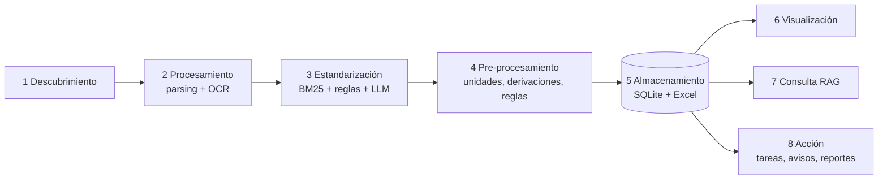

# NECC · Litigiosidad ART — MVP

Pipeline que toma las **Notas a los Estados Contables** de aseguradoras de riesgos del trabajo (PDF o imagen),
encuentra los indicadores de litigiosidad que exige la SSN (RGAA 33.4.1.6.1.6 y 30.1.1.3 d), los estandariza
al formato del *Excel base*, los valida, avisa a las personas cuando algo no cierra y permite consultarlos.

## Ejecutar

```bash
cd mvp
uv sync
cp .env.example .env                                    # completar GEMINI_API_KEY
npm --prefix web install && npm --prefix web run build  # interfaz web (una sola vez)
uv run necc ejecutar data/muestras                      # procesa los 6 PDFs de ejemplo (~2 min)
uv run necc ui                                          # API + interfaz: http://localhost:8000
```

Para modificar la interfaz con recarga en caliente: `uv run necc ui` en una terminal y `npm --prefix web run dev`
en otra (http://localhost:5173; las llamadas a `/api` se redirigen a la API).

Otros comandos (`uv run necc --help`):

| Comando | Qué hace |
|---|---|
| `descubrir [rutas]` | Registra archivos de `data/inbox` (o de las rutas dadas) |
| `procesar [ids] [--todos] [--sin-llm]` | Corre el pipeline sobre documentos registrados |
| `vigilar [--intervalo 10]` | Vigila `data/inbox` y procesa lo que llega |
| `estado` | Lista documentos y cuántas incidencias tienen para revisar |
| `consultar "pregunta"` | Pregunta en lenguaje natural con citas |
| `exportar [--salida x.xlsx]` | Excel base (hojas Base, Trazabilidad, Incidencias) |
| `reporte` | Reporte consolidado + notificación al responsable |
| `evaluar` | Reglas vs LLM vs híbrido contra `eval/gold.yaml` → `eval/resultados.md` |

`uv run pytest` corre las pruebas de la parte determinística.

## Proceso y módulos



| Módulo | Archivo | Responsabilidad |
|---|---|---|
| 1 Descubrimiento | `src/necc/m1_descubrimiento.py` | Carpeta de entrada, subida web, vigilancia; deduplicación por SHA-256; copia inmutable del original |
| 2 Procesamiento | `src/necc/m2_procesamiento.py` | Texto nativo (PyMuPDF), OCR de páginas escaneadas o cuadros en imagen (Gemini visión / Tesseract), limpieza, fragmentos |
| 3 Estandarización | `src/necc/m3_estandarizacion.py` | Localiza páginas (BM25 + ontología), extrae por reglas y por LLM (JSON validado), verifica que el número exista literalmente, fusiona |
| 4 Pre-procesamiento | `src/necc/m4_preprocesamiento.py` | Derivaciones (sumas/restas), unidades a pesos, barandilla de unidad, reglas de negocio → incidencias, estado por campo |
| 5 Almacenamiento | `src/necc/m5_almacenamiento.py` | Esquema SQLite, persistencia, correcciones humanas auditadas, exportación a Excel |
| 6 Visualización | `src/necc/m6_visualizacion/api.py` + `web/` | API FastAPI (procesa en segundo plano) + interfaz React: Documentos (carga y avance), Documento (revisión con el valor resaltado en el PDF), Tablero, Consulta, Acciones |
| 7 Consulta | `src/necc/m7_consulta.py` | RAG híbrido (BM25 + embeddings, RRF) con citas y registro de consultas |
| 8 Acción | `src/necc/m8_accion.py` | Ruteo de incidencias a responsables, notificaciones (bandeja / Slack / email), etiquetado manual, reportes |
| Orquestador | `src/necc/pipeline.py` | Ejecuta las etapas y registra cada una en la bitácora. Si el LLM o el OCR fallan, sigue con las reglas y abre una incidencia; sin embeddings, la consulta usa solo BM25 |

Configuración de negocio (sin tocar código):

- `config/ontologia.yaml`: campos del Excel base, sinónimos, criterios, componentes, derivaciones y reglas de validación.
- `config/responsables.yaml`: personas, ruteo de incidencias y acción sugerida por tipo de problema.

## Criterios de negocio aplicados

- **Reserva por reclamaciones judiciales**: neta de las porciones a cargo del FFEP y del reaseguro.
- **Pasivo global**: bruto. Si la entidad solo informa el neto, se calcula como neto + pagos parciales.
- **Juicios abiertos**: total, incluidos COVID. Si se informa separado, se suman los juicios sin y con pagos parciales.
- **Cuadros comparativos**: siempre el período de la fecha de balance.

## Datos de ejemplo

- `data/muestras/doc_{1,2,3}.pdf`: notas reales al 31/03/2026.
- `data/muestras/sinteticos/`: tres casos construidos con fragmentos de `Info NECC.docx`, el requerimiento del cliente. Cubren un cuadro escaneado, un comparativo escaneado en miles y prosa en la que la reserva hay que restarla. Los PDFs ya generados están en el repo; el requerimiento no se publica, así que regenerarlos (`uv run python eval/generar_sinteticos.py "../Info NECC.docx"`) requiere tener ese archivo.
- `eval/gold.yaml`: valores correctos verificados a mano. `eval/resultados.md` guarda la última evaluación.
